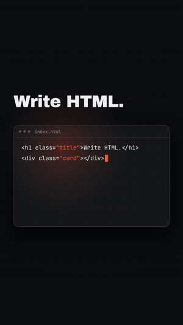

# Claude Video Toolkit

One prompt that sets up a free toolkit for making short videos as code with Claude: HTML-to-MP4 rendering, animation skills, CC0 sound effects and a lossless trimming tool. Paste it into Claude, answer three questions, and it installs everything from official sources, checks licenses, and asks before anything risky.

  

The 10-second demo above was built with this toolkit: one GSAP timeline rendered to MP4 by HyperFrames, scored with CC0 sounds placed on each animation's start time. Sound version: [media/demo.mp4](media/demo.mp4).

## What it sets up

| Tool | What you get | License |
|---|---|---|
| [HyperFrames](https://github.com/heygen-com/hyperframes) | Write a video as HTML, render it to MP4 | Apache-2.0 |
| [GSAP skills](https://github.com/greensock/gsap-skills) | Official GSAP core and timeline skills for Claude | MIT |
| [anime.js](https://github.com/juliangarnier/anime) | Stagger animations for the web | MIT |
| [Manim Community](https://github.com/ManimCommunity/manim) | Math-style explainer animations | MIT |
| [Sonic Pi](https://sonic-pi.net) | Music by code, plus about 200 CC0 samples as a ready SFX kit | MIT core, see its LICENSE |
| [Tone.js](https://github.com/Tonejs/Tone.js) | Synths in the browser | MIT |
| [video-shotcraft](https://github.com/Vincentwei1021/video-shotcraft) | 124 Remotion shot recipe cards for motion ideas | Apache-2.0 (Remotion has its own license) |
| [Anthropic skills](https://github.com/anthropics/skills) | Official example skills, including a GIF maker | Mostly Apache-2.0 |
| [LosslessCut](https://github.com/mifi/lossless-cut) | Trim footage instantly without re-encoding | GPL-2.0 |
| [Kenney audio](https://kenney.nl/assets/category:Audio) | CC0 sound packs, sorted for video edits | CC0 |

It also includes a security checklist for vetting any third-party agent skill before you install it, and an ffmpeg recipe for placing sound effects on an animation timeline.

## How to use it

1. Open Claude somewhere it can run commands (Claude Code, or Claude with a cloud workspace).
2. Paste the whole of [`toolkit-prompt.md`](toolkit-prompt.md), or attach the file.
3. Answer its three questions: where to install tools, where your sound effects live, and your OS.
4. Pick the sections you want. It sets them up one at a time and reports what it did.

Desktop apps (Sonic Pi, LosslessCut) are installed by you from the official links it gives you; Claude then verifies them.

## Good to know

- Tested on 2026-10-26. Versions and links change, so the prompt tells Claude to check each project's README and follow it when it differs.
- No API keys or passwords are needed for the core setup. If a step ever needs one, Claude stops and tells you which environment variable to set yourself.
- This repo only contains instructions and links. Every tool keeps its own license; read it before commercial use.

## License

MIT for the prompt and this README. See [LICENSE](LICENSE). The demo sounds are CC0 samples bundled with Sonic Pi.
